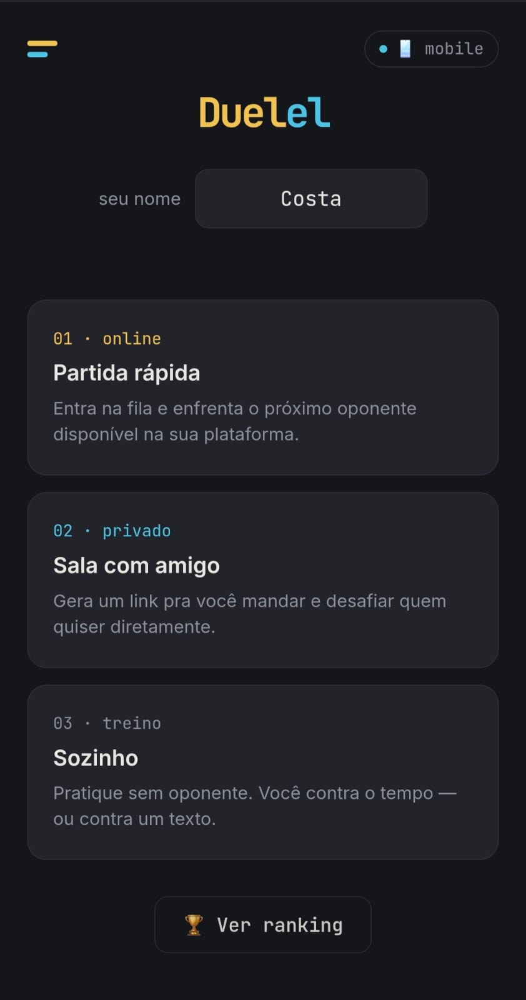
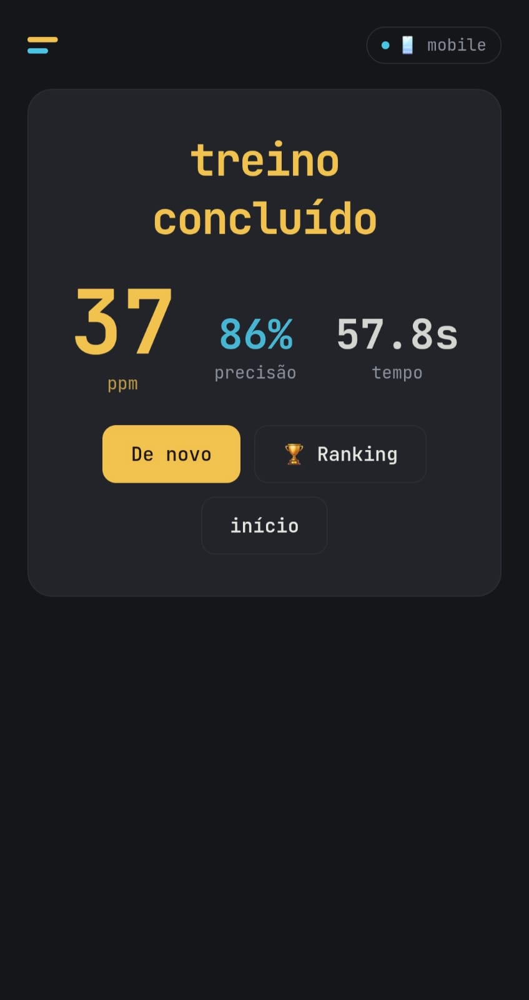

<p align="center">
  <a href="https://duelel.cyberhat.com.br"></a>
  &nbsp;
  <a href="https://duelel.cyberhat.com.br"></a>
</p>

<p align="center">
  <a href="https://duelel.cyberhat.com.br"><b>Jogar agora</b></a> · <a href="README.en.md">Read in English</a>
</p>

# Duelel

Corrida de digitação em tempo real. A ideia é simples: um jogo de digitação, mas competindo direto contra outra pessoa.

**No ar em:** https://duelel.cyberhat.com.br

Esse projeto nasceu em outubro de 2021, como o meu primeiro jogo para Web. Desses anos para cá, com tudo o que aprendi trabalhando como dev, decidi refazer o jogo do zero, colocando o meu conhecimento em prática e melhorando tudo o que era antes um site simples com um jogo de digitação.

## O que dá pra fazer no jogo

- Duelo online contra outra pessoa, via partida rápida (matchmaking automático) ou sala privada por link
- Treino sozinho, em dois formatos: um texto fixo pra terminar ou 30 segundos correndo contra o relógio
- Ranking com melhores PPM, separado por plataforma
- Interface em PT-BR e EN, com detecção automática pelo idioma do navegador
- Instalável como PWA (funciona offline nos modos solo/tempo) e empacotado pra Google Play (ainda em fase de testes antes de ser lançado)

## Stack

**Front-end:** HTML/CSS/JS puro. Queria ver até onde dava pra levar sem React/Vue, e no fim ajudou a manter o app leve e rápido de carregar.

**Back-end:** Node.js com o módulo `http` nativo servindo os arquivos estáticos, `ws` cuidando do WebSocket (matchmaking, salas, sincronização da corrida em tempo real) e `pg` guardando o ranking num banco Postgres (Supabase).

**Deploy:** Render, com deploy automático a cada push no GitHub. O ranking mora no Postgres do Supabase (via a variável `DATABASE_URL`), então sobrevive a redeploys e restarts independente do plano do Render.

## Como funciona o multiplayer

- Ao entrar na fila, o servidor te agrupa com jogadores compatíveis (mesma plataforma, mesma preferência de acento na versão em português, mesmo idioma).
- Só quando os dois confirmam é que o servidor sorteia o horário de largada e manda o texto pros dois ao mesmo tempo. Cada tecla digitada é retransmitida pro adversário via WebSocket, e o próprio servidor decide o vencedor (por tempo de conclusão) evitando que o cliente minta sobre o resultado.

## Rodando local

```bash
npm install
npm start
```

Abre em `http://localhost:8080`. Pra testar um duelo, abra duas abas (ou dois dispositivos na mesma rede).

Sem a variável `DATABASE_URL` apontando pra um banco Postgres, o servidor sobe do mesmo jeito, só o ranking fica desativado, o resto funciona normal.

## Estrutura

```
server.js                  server (http + websocket + postgres)
package.json
render.yaml                 blueprint de deploy do Render
public/
  index.html                o app inteiro — front-end, sem build step
  manifest.webmanifest      PWA
  sw.js                     service worker (cache offline pros modos solo/tempo)
  icons/                    ícones do app
  privacidade.html          política de privacidade
Caddyfile, deploy/          configs de referência (nginx, systemd) pra quem for hospedar em VPS próprio
```
